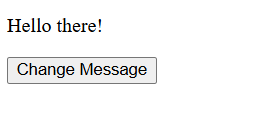
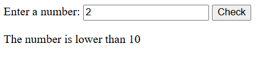
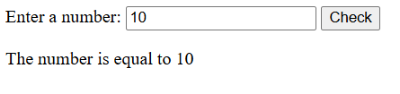
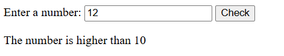
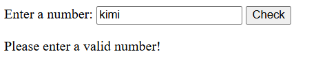
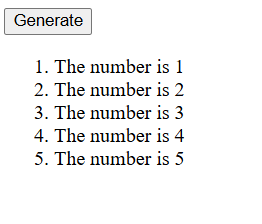
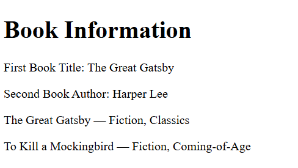
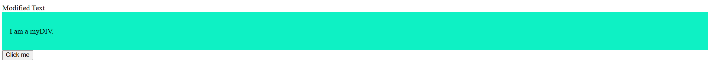
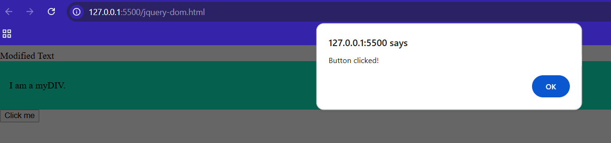

# Lab 4 - JavaScript Basics, JSON Fetching & jQuery

## Student Information
- **Name:** MUHAMMAD HAKIMI FIKRI BIN MOHD PADZLAN
- **Student ID:** AI240071
# BIC21203 Web Development - Lab 4

---

## Overview & Brief Explanation
This repository contains the completed work for **Lab 4a** and **Lab 4b**, demonstrating fundamental JavaScript practices, asynchronous JSON data fetching, and dynamic DOM manipulation using jQuery.

---

## Instructions to Run
1. Clone or download this repository to your local machine.
2. Open the project folder in **Visual Studio Code**.
3. Launch **Live Server** in VS Code to run the HTML files (required to avoid browser CORS/security blocks when fetching JSON data).

---

## Lab 4a: CLIENT-SIDE SCRIPTING (JAVASCRIPT)

### Overview
Focuses on basic JavaScript concepts including variable handling, conditional logic, input validation using `.trim()`, and dynamic element generation.

### Outputs & Screenshots

#### Question 1: Interactive Text Changer
* **Description:** This task uses JavaScript DOM selection methods to target both the button and the message paragraph. An event listener is attached to the button to wait for a user click. Once clicked, the function runs and updates the paragraph text to "Hello there!".

**Before Input / Initial State:**

**After Validation / Output Generated:**

#### Question 2:  Smart Number Validator
* **Description:** This task uses the DOM to retrieve the user's input and validates it using .trim() and isNaN() to check for empty or non-numeric entries. If valid, conditional statements compare the number against 10 and update the result paragraph with the appropriate message.

**Output:**

#### Question 3: Dynamic Number Generator
* **Description:** This task uses a for loop to dynamically generate a sequence of numbers from 1 to 5 when the button is clicked. It creates new list item elements (<li>) using DOM manipulation methods and appends them into the ordered list (<ol>) on the page.

**Output:**

---

## Lab 4b: Asynchronous JavaScript (JSON) & jQuery DOM Manipulation

### Overview
Focuses on asynchronous web operations using the `fetch()` API with local JSON datasets, as well as selection, style modifications, and event listening using jQuery.

### Outputs & Screenshots

#### Question 2: JSON Data Fetching (`books.html`)
* **Description:** Asynchronously loading and displaying book records from `books.json`.

#### Question 3: jQuery DOM Manipulation & Events (`jquery-dom.html`)
* **Description:** Dynamic text replacement, CSS class assignment (`.addClass()`), and button click event listener (`.on("click")`).

 Before Interaction 
|  | 

 After Interaction (Button Clicked) 
   |